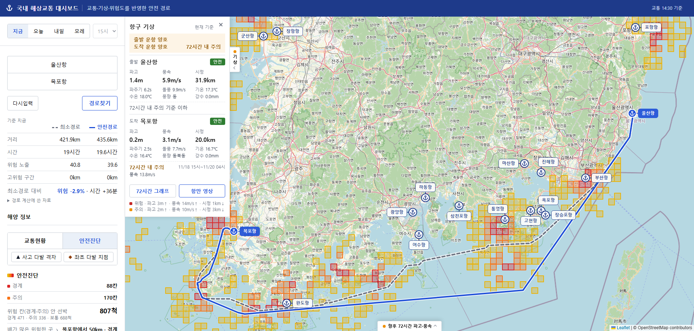
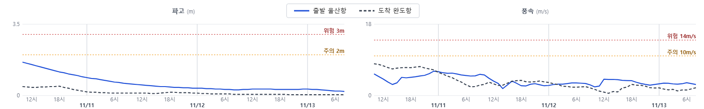

# 🚢 해상교통 안전경로 예측 시스템

국내 무역항 31곳의 **실시간 해상교통량 · 사고위험 예보 · 기상**을 한 화면에 모아, 출발항과 도착항 사이의 **최소경로와 안전경로를 함께 계산**하는 웹 서비스입니다.

> 4인 팀 프로젝트 **Hello_World** (2026.10.17 ~ 11.12) · 그린AI캠퍼스 평생교육원
> 팀 저장소 [`ung-Jin/Navigate`](https://github.com/ung-Jin/Navigate) 의 fork 입니다.

---

## 👥 팀원

| 담당 | 범위 |
|---|---|
| 이웅진 | 공통 기반 — 서버·지도 뼈대, 팀 코드 통합, 항만 CCTV |
| 최준영 | 교통과 위험 예보 — 실시간 선박 위치, 사고위험 예보, 사고·좌초 다발 지점 |
| 박성인 | 날씨와 데이터 검토 — 항구 72시간 예보, 기상 패널·그래프, 학습 데이터 점검 |
| **김성준** | **경로 예측 — 바다 격자, 최소·안전 경로, 위험 가중치** |

👉 제 작업: [`route` 패키지](https://github.com/rlawns2848-hue/Navigate/tree/dev/Navigate/src/main/java/com/green/Navigate/route) · [커밋 보기](https://github.com/ung-Jin/Navigate/commits/dev?author=rlawns2848-hue)

---

## 🛠 기술 스택

| | |
|---|---|
| **Backend** | Java 17 · Spring Boot 4.0.8 · MyBatis 4.0.1 · Thymeleaf · Lombok |
| **Database** | MariaDB |
| **Frontend** | JavaScript · Leaflet · OpenStreetMap |
| **격자 생성** | Python · NumPy |
| **External API** | KOMSA MTIS · Open-Meteo · 국립해양조사원 CCTV |

---

## ✨ 주요 기능

### 경로 탐색

출발항 · 도착항 · 출항 시각을 고르면 **최소경로(점선)** 와 **안전경로(실선)** 를 함께 그리고, 거리 · 시간 · 위험 노출을 나란히 비교합니다.



### 교통현황

실시간 선박 위치를 격자 단위로 모아 **밀집도를 색으로** 보여줍니다. 칸을 누르면 선박 수 · 사고위험 등급 · 파고 · 풍속이 뜹니다.


### 안전진단

출발항과 도착항의 **72시간 파고 · 풍속을 한 그래프에** 겹쳐 봅니다. 위험선과 주의선을 미리 그어 뒀습니다.



---

## ⚙️ 실행 방법

```bash
mysql -u user -p navigate < Navigate/sql/ports.sql
cd Navigate && ./gradlew bootRun
```

`Navigate/.env` 에 접속 정보와 인증키가 필요합니다.

```properties
DB_HOST=
DB_PASSWORD=
MTIS_KEY=          # 공공데이터포털 - 한국해양교통안전공단 MTIS
CCTV_BASE=         # 국립해양조사원 항만 영상 (이용조건상 비공개)
```
