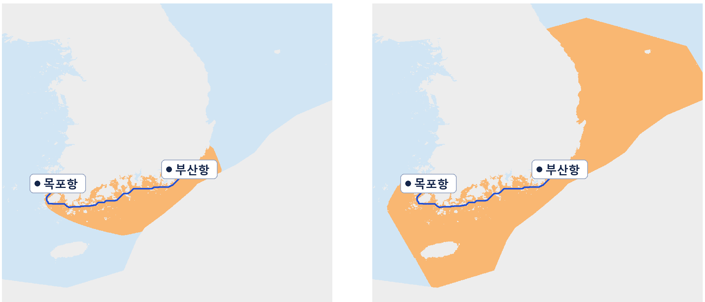

# 해상교통량 측정 및 안전진단 최소경로 예측 시스템

국내 무역항 31곳을 대상으로 **실시간 해상교통량과 사고위험 예보를 반영한 안전 항로**를 계산하는 웹 서비스입니다.
출발항과 도착항을 고르면 거리만 따진 **최소경로**와 위험을 피해 가는 **안전경로**를 함께 보여주고, 두 경로의 거리·시간·위험 노출을 비교합니다.


*울산항 → 제주항. 점선이 최소경로, 파란 실선이 안전경로입니다. 왼쪽 사이드바의 거리·시간·위험 노출·고위험 구간이 제가 계산하는 값입니다.*

> 4인 팀 프로젝트 **Hello_World** (2026.10.17 ~ 11.12) · 그린AI캠퍼스 평생교육원
> 이 저장소는 팀 저장소 [`ung-Jin/Navigate`](https://github.com/ung-Jin/Navigate) 의 fork 입니다.

---

## 담당 범위

**경로 탐색 전체 (`route` 패키지)를 맡았습니다.**

📁 **[`src/main/java/com/green/Navigate/route`](https://github.com/rlawns2848-hue/Navigate/tree/dev/Navigate/src/main/java/com/green/Navigate/route)** ← 이 폴더 전체가 제가 만든 코드입니다

| 파일 | 하는 일 |
|---|---|
| `service/SeaGrid.java` | 해안선을 500m 격자로 변환 · 항구↔바다 칸 연결 · BFS 로 고립 해역 제거 |
| `service/AStar.java` | A\* 경로 탐색 · 대각선 통과 제한 · 격자 경로를 직선으로 펴기 |
| `service/RiskMap.java` | 교통·사고위험 예보·기상을 0~1 로 맞춰 칸별 위험도로 조립 |
| `service/RouteService.java` | 최소경로·안전경로 계산 · 거리/시간/위험 측정 · 경로 캐싱 |
| `util/GeoUtil.java` | 하버사인 거리 계산 |
| `controller/RouteApiController.java` | `GET /api/route` |
| `dto/RouteDTO.java` · `dto/RoutePathDTO.java` | 응답 구조 |
| `static/js/route.js` · `route-grid.js` | 지도에 두 경로 그리기 · 비교표 렌더링 |

🔗 **[팀 저장소에서 제 커밋만 보기](https://github.com/ung-Jin/Navigate/commits/dev?author=rlawns2848-hue)**

---

## 결과

```
육지 통과율      3~16%  →  0.136%      격자 2.5km → 500m, 통과 기준 바다 30% → 80%
위험 점수        평균 -22.6%            무역항 30곳 전수 조합 435쌍 · 역전 0쌍 · 경로 못 찾음 0쌍
경로 탐색 속도    4.4배                  부산항→목포항 93,375칸 vs 다익스트라 413,890칸 (경로 동일)
가중치 판별력     79.8%  →  85.6%        조합 11가지를 사고다발 26칸으로 채점해 선정
```

> **-22.6% 는 사고가 그만큼 줄어든다는 뜻이 아닙니다.** 저희가 매긴 위험 점수가 최소경로 대비 평균 22.6% 낮다는 뜻입니다. 점수를 저희가 만들었으니 이 숫자도 저희 기준 안에서만 의미가 있습니다.

---

## 동작 흐름

```
1. 자료 수집     KOMSA MTIS (실시간 선박·사고위험 예보·사고다발) · Open-Meteo (항구 72시간 예보)
                 10분 / 1시간 / 30분 주기

2. 바다 격자     OpenStreetMap 해안선 → 1400 x 1600 격자 (500m)
                 칸마다 바다 비율 저장, 80% 이상만 통과 가능

3. 위험도 조립    교통 혼잡 · 사고위험 예보 · 파고/풍속을 각각 0~1 로 변환
                 위험도 = 0.50 x 교통 + 0.30 x 예보 + 0.20 x 기상

4. 경로 탐색     간선 비용 = 거리 x (1 + α x 위험도)
                 α = 0  →  최소경로      α = 3  →  안전경로
```

### 설계에서 신경 쓴 것

- **격자 해상도를 MTIS 칸에 맞췄습니다.** `0.025 ÷ 0.005 = 5` 로 정확히 나누어떨어져, 위험도를 가져올 때 칸 번호를 5로 나누기만 하면 됩니다.
- **위험을 거리로 환산했습니다.** 거리와 안전은 동시에 최적화할 수 없어, 위험도 1인 칸은 거리가 4배로 계산되게 두고 A\* 가 알아서 저울질하게 했습니다. 피할 칸을 따로 지정하는 임계값은 두지 않았습니다.
- **항구 둘레 5km 는 할증을 깎습니다.** 항구 앞이 위험하다고 입항을 안 할 수는 없기 때문입니다. 위험 점수 자체는 그대로 두고 경로를 고를 때의 비용만 줄였습니다.
- **내륙 항만은 격자가 걸러냅니다.** 서울항은 한강 안쪽이라 15km 안에 통과 가능한 바다 칸이 없습니다. 항구 이름을 코드에 적는 대신 격자로 판정해, 다른 내륙 항만이 추가돼도 코드 수정이 필요 없습니다.

### 다익스트라 대신 A\* 를 쓴 이유



코드 차이는 **남은 직선거리를 비용에 더하는 한 줄**뿐입니다. 왼쪽이 A\*, 오른쪽이 다익스트라이고 주황이 살펴본 칸, 파랑이 최종 경로입니다.

```
부산항 → 목포항      A*  93,375칸 · 0.82초      다익스트라  413,890칸 · 3.24초
```

**경로는 완전히 같습니다.** 직선거리는 실제 바닷길보다 길 수 없어서, 더해도 최적 경로를 놓치지 않습니다.

---

## 가장 크게 배운 것

격자 위에서 항구 30곳의 모든 조합 435쌍을 검사해 **"전부 통과"** 를 받았습니다.
그런데 화면을 보니 경로가 섬을 그대로 지나가고 있었습니다.

```
검증 기준 = 내가 만든 2.5km 격자
검증 대상 = 그 격자로 만든 경로
            ↑ 같은 자료로 채점하니 당연히 통과
```

원본 해안선(110m)으로 다시 재니 경로의 **3~16% 가 육지 위**였습니다.
격자를 500m 로 줄이고 통과 기준을 80% 로 올려 0.136% 까지 내렸습니다.

> 스스로 만든 자로 자기 결과를 재면 항상 맞다고 나옵니다. 자는 밖에서 가져와야 합니다.

---

## 알려진 제약 · 보완할 점

435쌍을 전수로 돌려 숫자를 확정하면서 **아직 안 되는 것도 같이 세어 뒀습니다.**

- **홀드아웃이 없습니다.** 가중치를 사고다발 26칸으로 고르고, 평가도 같은 26칸으로 했습니다. 따로 떼어 둔 자료로 다시 확인하지 못했습니다 — 26칸이라 나눌 수도 없었습니다
- **기상 비중 0.20 은 검증하지 못했습니다.** 측정한 날 바다가 잔잔해서 기상 점수가 0이 아닌 칸이 6,497개 중 2개뿐이었습니다. 실제로 검증된 건 교통 : 예보 비율입니다
- **수심·조류·선종이 없습니다.** 격자가 해안선만으로 만든 2차원이라 깊이 축 자체가 없습니다. 속도도 12노트 고정이라 선종을 고를 수 없습니다
- **육지 통과가 0 이 아닙니다.** 격자가 육지를 20%까지 허용하고, 항구에서 첫 바다 칸까지 잇는 구간은 검사를 거치지 않습니다
- **사고다발·좌초 지점을 경로에 직접 넣지 못했습니다.** 사고다발 26칸은 가중치를 고를 때 정답지로 썼고, 좌초 87곳은 화면에 표시만 합니다

네 번째가 가장 큽니다. `0.136%` 는 300km 경로에서 **약 400m 가 육지 위**라는 뜻입니다.

```
육지 통과는 평균으로 볼 지표가 아닙니다
434쌍이 완벽해도 한 쌍에서 걸리면 좌초입니다
```

> 그래서 이 시스템은 **출항 전에 어느 쪽이 덜 위험한지 비교해 보는 참고 도구**지 항법 장비가 아닙니다. 육지 통과가 0 이 되어도 수심과 해도가 없어서 실제 항해에는 쓸 수 없습니다.

---

## 기술 스택

| | |
|---|---|
| **Backend** | Java 17 · Spring Boot 4.0.8 · MyBatis 4.0.1 · Thymeleaf · Lombok |
| **Database** | MariaDB |
| **Frontend** | JavaScript · Leaflet · OpenStreetMap |
| **격자 생성** | Python · NumPy |
| **External API** | KOMSA MTIS · Open-Meteo · 국립해양조사원 CCTV |
| **협업** | Git (dev / feature 브랜치 · Pull Request) |

---

## 실행 방법

### 1. 데이터베이스

```bash
mysql -u user -p navigate < Navigate/sql/ports.sql
```

### 2. `Navigate/.env` 작성

인증키와 접속 정보는 깃에 올리지 않습니다. 아래 네 항목이 필요합니다.

```properties
DB_HOST=
DB_PASSWORD=
MTIS_KEY=          # 공공데이터포털 - 한국해양교통안전공단 MTIS
CCTV_BASE=         # 국립해양조사원 항만 영상 (이용조건상 비공개)
```

### 3. 실행

```bash
cd Navigate
./gradlew bootRun
```

`http://localhost:8080` 에서 확인할 수 있습니다.

---

## 팀 구성

| 담당 | 범위 |
|---|---|
| 이웅진 | 공통 기반 — 서버·지도 뼈대, 팀 코드 통합, 항만 CCTV |
| 최준영 | 교통과 위험 예보 — 실시간 선박 위치, 사고위험 예보, 사고·좌초 다발 지점 |
| 박성인 | 날씨와 데이터 검토 — 항구 72시간 예보, 기상 패널·그래프, 학습 데이터 점검 |
| **김성준** | **경로 예측 — 바다 격자, 최소·안전 경로, 위험 가중치** |
