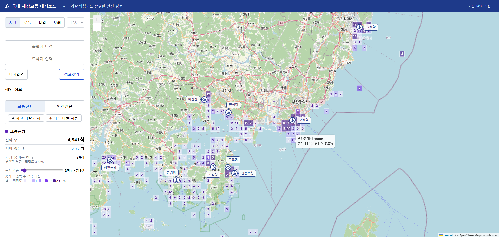
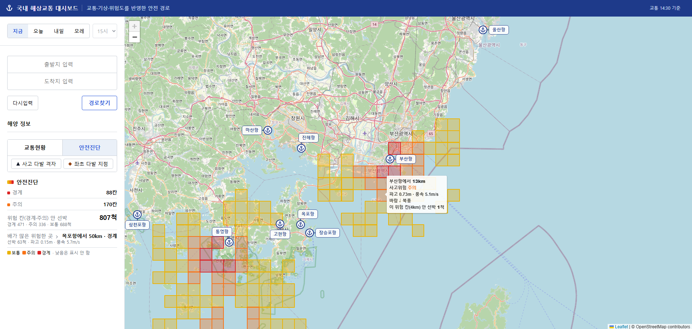

# 🚢 해상교통량 측정 및 안전진단 최소경로 예측 시스템

국내 무역항 31곳의 **실시간 해상교통량 · 사고위험 예보 · 기상**을 한 화면에 모아, 출발항과 도착항 사이의 **최소경로와 안전경로를 함께 계산**하는 웹 서비스입니다.

> 4인 팀 프로젝트 **Hello_World** (2026.10.17 ~ 11.12) · 그린AI캠퍼스 평생교육원
> 팀 저장소 [`ung-Jin/Navigate`](https://github.com/ung-Jin/Navigate) 의 fork 입니다.

---

## 👥 팀원

| 담당 | 범위 |
|---|---|
| 이웅진 | 공통 기반 — 서버·지도 뼈대, 팀 코드 통합, 항만 CCTV |
| 최준영 | 교통과 위험 예보 — 실시간 선박 위치, 사고위험 예보, 사고·좌초 다발 지점 |
| 박성인 | 날씨와 데이터 검토 — 항구 72시간 예보, 기상 패널·그래프, 학습 데이터 점검 |
| **김성준** | **경로 예측 — 바다 격자, 최소·안전 경로, 위험 가중치** |

👉 제 작업: [`route` 패키지](https://github.com/rlawns2848-hue/Navigate/tree/dev/Navigate/src/main/java/com/green/Navigate/route) · [커밋 보기](https://github.com/ung-Jin/Navigate/commits/dev?author=rlawns2848-hue)

---

## 🛠 기술 스택

| 구분 | 기술 |
|---|---|
| **Backend** | Java 17 · Spring Boot 4.0.8 · MyBatis 4.0.1 · Thymeleaf · Lombok |
| **Database** | MariaDB |
| **Frontend** | JavaScript · Leaflet · OpenStreetMap |
| **격자 생성** | Python · NumPy |
| **External API** | KOMSA MTIS · Open-Meteo · 국립해양조사원 CCTV |

---

## ✨ 주요 기능

### 경로 탐색

출발항 · 도착항 · 출항 시각을 고르면 **최소경로(점선)** 와 **안전경로(실선)** 를 함께 그립니다. 거리 · 시간 · 위험 노출 · 고위험 구간을 나란히 놓고, 최소경로 대비 얼마나 달라지는지 보여줍니다.


*울산항 → 목포항 · 421.9km / 435.6km · 시간 +36분. 깔려 있는 노랑 · 주황 · 빨강 칸이 사고위험 예보입니다 — 안전경로(실선)는 남해 섬 사이의 위험 구간을 비켜 바깥 바다로 돌아갑니다.*

고른 두 항구의 **72시간 파고 · 풍속**은 한 그래프에 겹쳐 봅니다. 실선이 출발지, 점선이 도착지이고 위험선과 주의선을 미리 그어 뒀습니다.


### 교통현황

실시간 선박 위치를 격자로 모아 보여줍니다. **숫자는 그 칸의 선박 수, 색은 밀집도**입니다. 칸을 누르면 가까운 항구에서 얼마나 떨어진 자리인지와 선박 수 · 밀집도가 뜹니다.

바다 전체를 칠하면 어디가 붐비는지 안 보여서, **표시 기준을 조절해 몇 척 이상인 칸만 남길 수 있게** 했습니다.



*선박 4,941척 · 선박이 있는 칸 2,061칸 · 가장 붐비는 칸은 부산항 부근 79척(밀집도 39.2%)*

### 안전진단

해양사고 위험 예보를 색 격자로 깔아 줍니다. 바다 대부분이 '낮음'이라 다 칠하면 위험한 곳이 묻혀서, **보통 이상만 남겼습니다.** 색도 교통현황(보라)과 겹치지 않게 골랐습니다.

```
보통 노랑  ·  주의 주황  ·  경계 빨강      낮음은 그리지 않습니다
```

칸을 누르면 **사고위험 등급 · 파고 · 풍속 · 풍향**과 그 칸 안에 지금 몇 척이 있는지가 함께 뜹니다. 사고 다발 격자와 좌초 다발 지점도 겹쳐 볼 수 있습니다.



*경계 88칸 · 주의 170칸 · 위험 칸 안에 선박 807척 · 배가 가장 많은 위험한 곳은 목포항에서 50km 지점(63척)*

---

## 🌐 사용한 공공 API

| 출처 | 받는 자료 |
|---|---|
| **KOMSA MTIS** | 실시간 선박 위치 · 해양사고 위험 예보 · 혼잡 예보 · 사고 다발 격자 · 좌초 다발 지점 |
| **Open-Meteo** | 항구별 72시간 파고 · 풍속 · 시정 예보 |
| **국립해양조사원** | 항만 CCTV 영상 (무역항 31곳 중 11곳 제공) |
| **OpenStreetMap** | 해안선 — 바다 격자를 만드는 원본 · 지도 타일 |

---

## ⚙️ 실행 방법

```bash
mysql -u user -p navigate < Navigate/sql/ports.sql
cd Navigate && ./gradlew bootRun
```

DB 접속 정보와 API 인증키(`MTIS_KEY` · `CCTV_BASE`)는 `Navigate/.env` 로 관리합니다.
